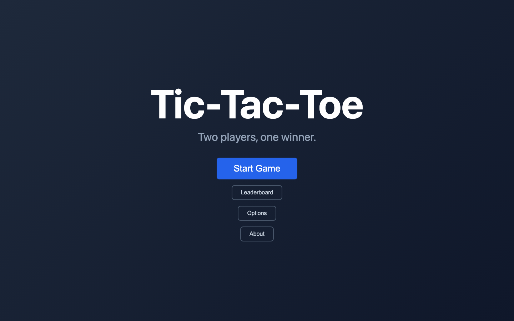
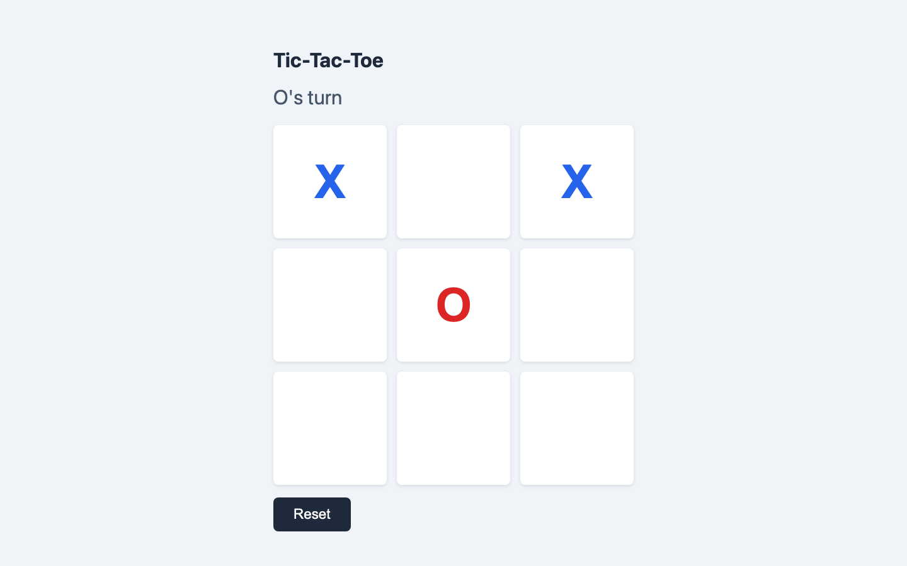
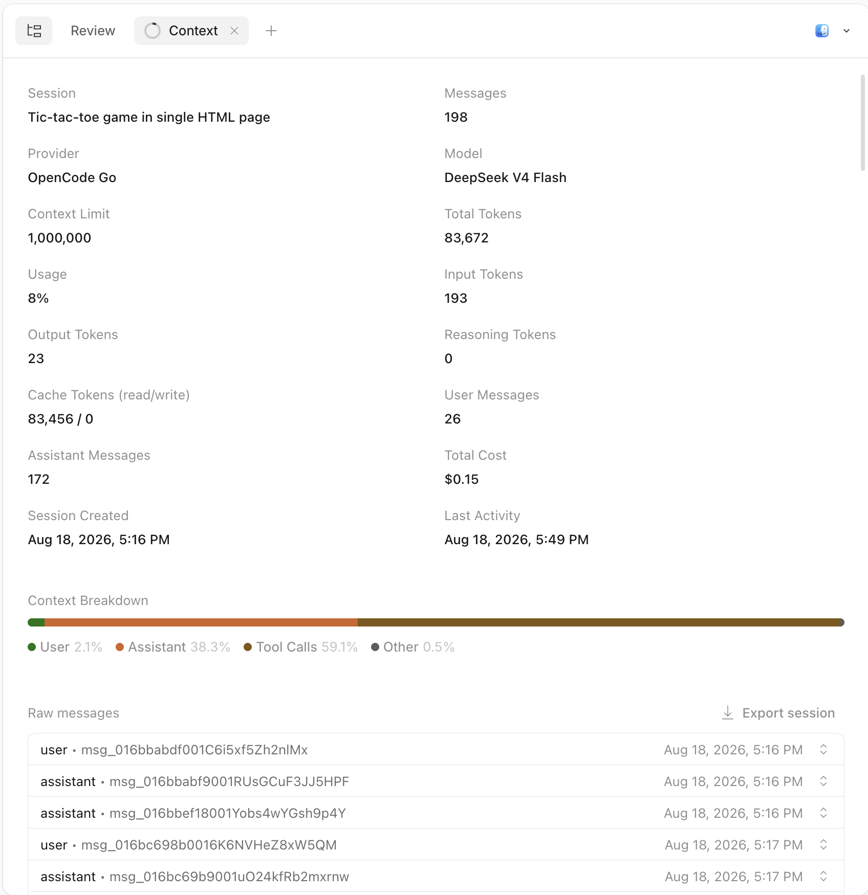

# Vibe Tic-Tac-Toe

> **"The Most Vanilla Game of Tic-Tac-Toe You Will Ever Play!"**
> *Built in 33 minutes for $0.15 of AI tokens—because every great architectural experiment needs a control group.*

### 👉 [**▶ Play Live in Your Browser (`v-ttt.livive.net`)**](https://v-ttt.livive.net/)

[](https://v-ttt.livive.net/)

[**▶ Play Live (`v-ttt.livive.net`)**](https://v-ttt.livive.net/) · [**📺 Featured on Livive.net**](https://beta.livive.net/#project=vibe-tic-tac-toe)

---

## Why Does This Exist? (The Tic-Tac-Toe Trilogy)

Yes, it is 3×3 Tic-Tac-Toe. Yes, it is two-player local pass-and-play—so if you click **Play Live** alone at your desk, your right hand is playing against your left hand. And yes, if both of your hands are paying attention, it will end in a draw.

Because everyone already knows the rules of Tic-Tac-Toe, it serves as the **control variable** across three sibling experiments that isolate radically different software architectures:

| Act | Project | Architectural Paradigm |
| :--- | :--- | :--- |
| **Act I** | **[`vibe-tic-tac-toe`](https://v-ttt.livive.net/)** *(You are here)* | **The $0.15 Client-Side Baseline:** 100% static HTML/CSS/JS + `localStorage`. Zero backend, zero networking—testing how much UI polish (emoji themes, Web Audio synth, confetti, persistent stats) an AI agent can ship in a single 33-minute, 15-cent session. |
| **Act II** | **[`fast-ttt`](https://github.com/jpeckenpaugh/fast-ttt)** | **"Look Ma, No Browser!" (`curl` + ASCII + FastAPI):** Strips out HTML, CSS, JS, and even JSON. Two players compete entirely via `curl` requests over plain-text HTTP backed by atomic SQLite transactions. |
| **Act III** | **[`p2p-ttt`](https://github.com/jpeckenpaugh/p2p-ttt)** | **"Look Ma, No Backend!" (Serverless WebRTC + WASM SQLite):** Strips out the server entirely. Two browsers pair via copy-pasted deep links, exchange moves peer-to-peer over WebRTC DataChannels, and persist full match replays in an in-browser WebAssembly SQLite (`sql.js`) database. |

---

## How to Play

1. **Start a Match:** Open [**`v-ttt.livive.net`**](https://v-ttt.livive.net/) and click **Start Game**.
2. **Make Your Move:** Player `X` goes first. Hover over any open square to preview your piece, and click to place it.
3. **Win (or Draw Trying):** Line up 3 in a row horizontally, vertically, or diagonally to trigger the pulsing win-line highlight, Web Audio fanfare, and a 60-piece confetti celebration.
4. **Customize the Vibe:** Click **Options** on the title screen to switch between **6 Piece Themes** (`Classic X/O`, `🐱 Cats & Dogs`, `⭐ Stars & Moon`, `⚔️ Swords & Shields`, `❤️ Hearts`, `🍕 Pizza & Burger`), pick custom hex colors for X and O, or toggle synthesized sound effects.
5. **Track the Rivalry:** Click **Leaderboard** to view cumulative `X` wins, `O` wins, and draws persisted in `localStorage`.



---

## The $0.15 Vibe-Coding Receipt

This entire repository was built in a single **OpenCode** session using **DeepSeek V4 Flash** to test low-cost agentic iteration:



- **Model:** OpenCode Go · DeepSeek V4 Flash
- **Total Cost:** **$0.15** across ~33 minutes
- **Messages:** 198 (26 user prompts, 172 assistant steps)
- **Tokens:** 83,672 total (83,456 cached reads · 193 input · 23 output)

---

## For Developers: Clone, Fork & Run Locally

Zero dependencies and zero build step—just plain HTML, CSS, and JavaScript.

```bash
git clone https://github.com/jpeckenpaugh/vibe-tic-tac-toe.git
cd vibe-tic-tac-toe
./run.sh
```

Then open **`http://localhost:8080`** in your browser (or open `index.html` directly).

### Repository Layout

```text
vibe-tic-tac-toe/
├── index.html   # Title screen, 3x3 board, Leaderboard, Options & About modals
├── style.css    # Responsive viewport scaling, win-pop animations & confetti
├── script.js    # Turn logic, theme/color persistence & Web Audio synth effects
├── run.sh       # Starts a local Python HTTP server on port 8080
└── docs/        # Screenshots and OpenCode session token/cost receipt
```
